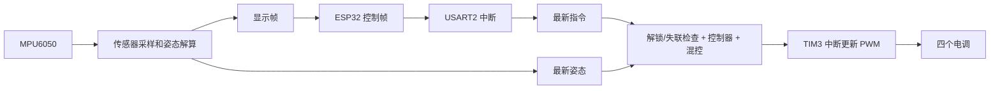
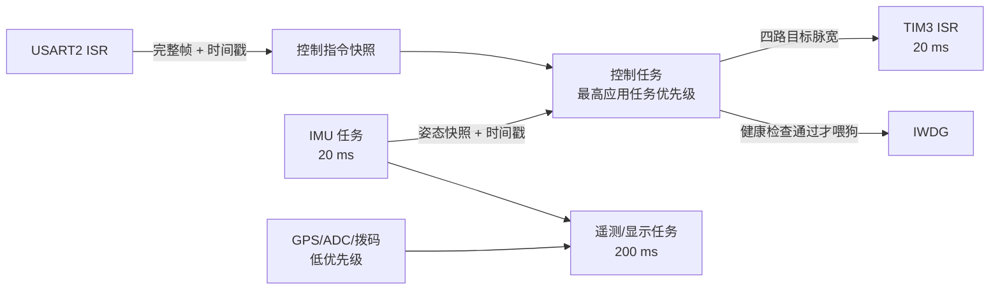

---
tags:
  - 四旋翼
  - STM32F411
  - FreeRTOS
  - 嵌入式学习
---

# 给当前 F411 飞控加入 FreeRTOS：思路与实施步骤

> [!abstract] 目标
> 在现有 GCC + Makefile 工程中手动加入 FreeRTOS，先保持飞控行为不变，再把控制、传感器和显示拆开。本文是实施路线与学习笔记，**当前仓库尚未加入 FreeRTOS**；下文的任务划分和配置值是建议，不代表已实现。

> [!danger] 调试前
> 最初的移植与调度测试请拆下四片螺旋桨。移植时中断、任务和看门狗都可能短暂失效，不能用装桨的电机测试来验证系统能否启动。

## 1. 先理解现在的程序

`main()` 完成 HAL、GPIO、ADC、电机和传感器初始化后，在 `while (1)` 中反复执行 `SensorApp_Poll()` → `MotorApp_Poll()`：见 [main.c](../Core/Src/main.c)。传感器轮询函数负责 GPS、拨码、约 20 ms 一次的 IMU/气压计采样，以及约 200 ms 一次的 ADC 和 OLED 页面发送，末尾还调用 `HAL_Delay(1)`：见 [sensor_app.c](../Core/Src/sensor_app.c)。其中显示帧使用阻塞式 `HAL_UART_Transmit(..., 30)`，所以控制调用可能被采样和显示拖后。

另一部分已经由中断驱动：USART1 接收 GPS，USART2 接收 ESP32 控制帧；TIM3 每 20 ms 把最新电机指令写入四路 PWM，并在主循环超过 250 ms 未更新时写入最小油门。独立看门狗约 2 s，当前由 `MotorApp_Poll()` 喂狗。见 [stm32f4xx_it.c](../Core/Src/stm32f4xx_it.c)、[motor_app.c](../Core/Src/motor_app.c)。这些保护在迁移后都要保留。



FreeRTOS 的作用是让这些工作按优先级调度，并用通知、队列等机制传递数据。**它不会自动提高姿态采样率，也不会自动修复 PID 参数。** 当前 [stabilizer.h](../Core/Inc/stabilizer.h) 中角度环 `P = 0`，先迁移调度，不要把参数调试与 RTOS 移植混成一项工作。

## 2. 推荐的迁移顺序

| 阶段 | 要做的事 | 验收标准 |
| --- | --- | --- |
| 0：保存基线 | 记录现有编译结果、RAM/Flash 占用、OLED/串口/电机行为；做一个独立 Git 提交 | 能随时回退到裸机版本 |
| 1：只接入内核 | 把原来的 `SensorApp_Poll()` 和 `MotorApp_Poll()` 原样放进**一个** `LegacyTask`；先别拆驱动 | 编译、启动、接收手机指令、显示和保护行为与原版一致 |
| 2：拆控制路径 | 传感器任务采样并发布姿态；控制任务在收到新姿态时运行，同时最多约 20 ms 超时醒来检查失联/过期 | 采样或串口异常时，电机仍能及时进入最小输出 |
| 3：拆慢路径 | GPS 解析、ADC、拨码和显示改为低优先级任务；避免慢 I²C/阻塞 UART 占用控制任务 | 屏幕更新时控制周期没有明显抖动 |
| 4：补诊断 | 测量任务栈余量、周期抖动和超时次数；验证任务卡死后的看门狗行为 | 失联、IMU 故障、任务停摆均能安全停机 |

第一阶段故意只建一个任务：一次只改变“谁调用主循环”，先排除内核移植问题。之后再逐项改变任务之间的数据交接。

## 3. 手工接入 FreeRTOS 的具体步骤

1. 从 [FreeRTOS-Kernel 官方仓库](https://github.com/FreeRTOS/FreeRTOS-Kernel)选一个**固定发布标签**，放到例如 `software/ThirdParty/FreeRTOS-Kernel/`。记录标签或提交号；不要直接依赖浮动的 `main` 分支。
2. 保持现有 `arm-none-eabi-gcc` 工具链。F411 使用 Cortex-M4F 且工程启用了硬件浮点；选择内核的 `portable/GCC/ARM_CM4F`。不用 IAR，也不需要重新生成 CubeMX 工程。
3. 修改 [Makefile](../Makefile)：增加 `include` 和 `portable/GCC/ARM_CM4F` 头文件路径；加入 `tasks.c`、`queue.c`、`list.c`、`portable/GCC/ARM_CM4F/port.c` 和**一个**内存管理实现（初学建议 `portable/MemMang/heap_4.c`）。将来用到软件定时器、事件组或流缓冲区，再核对所选版本所需的 `timers.c`、`event_groups.c`、`stream_buffer.c`。确保内核文件也使用现有的 M4F/硬浮点编译选项。
4. 新建 `software/Core/Inc/FreeRTOSConfig.h`，从所选版本官方示例出发填写配置。下面是本工程的**起点**，不是可以直接复制的完整配置：

   ```c
   #define configUSE_PREEMPTION                    1
   #define configCPU_CLOCK_HZ                       ( SystemCoreClock )
   #define configTICK_RATE_HZ                       1000
   #define configMAX_PRIORITIES                     5
   #define configMINIMAL_STACK_SIZE                 128  /* StackType_t 个数，不是字节 */
   #define configTOTAL_HEAP_SIZE                    ( 24 * 1024 ) /* 先估算，再实测 */
   #define configUSE_TICKLESS_IDLE                  0
   #define configLIBRARY_LOWEST_INTERRUPT_PRIORITY  15
   #define configLIBRARY_MAX_SYSCALL_INTERRUPT_PRIORITY 5
   #define configKERNEL_INTERRUPT_PRIORITY \
       ( configLIBRARY_LOWEST_INTERRUPT_PRIORITY << ( 8 - __NVIC_PRIO_BITS ) )
   #define configMAX_SYSCALL_INTERRUPT_PRIORITY \
       ( configLIBRARY_MAX_SYSCALL_INTERRUPT_PRIORITY << ( 8 - __NVIC_PRIO_BITS ) )
   ```

   `__NVIC_PRIO_BITS` 以本项目 CMSIS 设备头文件为准；F411 通常是 4。数字越小，中断抢占优先级越高。启用 `configASSERT`、栈溢出检查和任务栈余量查询，其他必需宏对照**所固定版本**的配置模板补齐。当前链接脚本给芯片定义 128 KiB RAM，并预留 4 KiB 主栈、2 KiB C 堆；FreeRTOS 的 `heap_4` 另用静态数组占 RAM，`configTOTAL_HEAP_SIZE` 不能把 128 KiB 全部拿走：见 [stm32f411xe.ld](../GCC/stm32f411xe.ld)。
5. 处理异常向量，不能保留两个同名处理函数。当前 [stm32f4xx_it.c](../Core/Src/stm32f4xx_it.c)已经定义了空的 `SVC_Handler`、`PendSV_Handler`，以及调用 `HAL_IncTick()` 的 `SysTick_Handler`。让 SVC/PendSV 直接由 FreeRTOS 的 M4F port 接管，例如按所选版本要求把 port 的处理函数映射到向量名，并删除本文件中冲突的空实现。**不要简单删除 SysTick 中的 `HAL_IncTick()`**：现有传感器、控制超时和 PWM 保护都依赖 `HAL_GetTick()`。
6. 第一阶段可让 HAL 和 RTOS 共用 1 kHz SysTick：`SysTick_Handler` 每次先更新 HAL tick；调度器启动后再调用 port 的 `xPortSysTickHandler()`。判断调度器是否已启动，避免在 `HAL_Init()` 和传感器初始化阶段调用 RTOS tick；所选 FreeRTOS 版本若用不同的向量安装方式，以该版本 port 的说明为准。后续若想让 HAL tick 独立于 RTOS，可改用 TIM6 作为 HAL timebase，但这是**另一个改动**，不要与首次启动内核同时做。
7. 初始化顺序保持 `HAL_Init()` → 时钟 → GPIO/ADC → 电机初始化 → 传感器初始化 → 创建 `LegacyTask` → 启动独立看门狗 → `vTaskStartScheduler()`。原 `while (1)` 不再承担正常调度；若 `vTaskStartScheduler()` 返回，应进入故障处理。第一阶段在 `LegacyTask` 内仍调用原两个 `Poll`；把任务中最后的 `HAL_Delay(1)` 换成 `vTaskDelay(pdMS_TO_TICKS(1))`，避免忙等。初始化阶段的 `HAL_Delay()` 可以暂时保留，因为调度器尚未启动。
8. 编译 `make -C software -j`，用 `arm-none-eabi-size software/build/quad.elf` 查看容量，再**拆桨烧录**验证。ESP32 工程暂时不需要改，手机 ↔ ESP32 ↔ F411 的串口协议也不需要改。

## 4. 拆任务时建议的数据流



建议控制任务优先级高于 IMU、遥测和 GPS 任务；IMU 任务高于遥测任务。`vTaskDelayUntil()` 适合固定周期采样；采样完成可用任务通知唤醒控制任务。**控制任务不能只等通知**：使用带上限的等待，例如 20 ms 超时也醒来检查控制帧失联、姿态是否超过 100 ms，以及自身是否应停机。TIM3 中断仍应保留它独立的 250 ms“控制循环停摆 → 最小 PWM”兜底。

`SensorApp_Poll()` 目前把快、慢操作混在一起，因此第二/三阶段需要先拆函数，再拆任务：

- IMU/姿态采样：拥有 I²C1 和姿态状态；发布**完整快照**（数值＋采样时间），不要让控制任务读到更新到一半的结构体。
- 控制任务：取得最新控制帧与姿态；运行原有 `MotorLogic_Update()`、`Stabilizer_Step()` 和电机映射。保留油门为 0、失联、姿态过期、计算失败时的最小输出与强制撤防逻辑。见 [motor_app.c](../Core/Src/motor_app.c)。
- 气压计、ADC、GPS、页面生成：低优先级；BMP388 高度、GPS、电池电压当前只供显示，不必排进电机控制任务。OLED 帧的阻塞发送尤其不要放在高优先级任务。
- I²C1 和 I²C2 是不同总线；同一总线如果以后有多个任务共用，应由单一任务拥有或加互斥锁。队列适合传**每一帧都要处理**的数据；最新遥控命令和姿态可用“覆盖式快照＋时间戳”避免积压旧数据。

## 5. 中断和共享数据：最容易出错的地方

1. 以 `configLIBRARY_MAX_SYSCALL_INTERRUPT_PRIORITY = 5` 为例：**只有数值为 5～15 的 IRQ** 才能调用 `...FromISR()` API；0～4 不能调用。当前 USART1/USART2 是 5、TIM3 是 6，见 [sensor_app.c](../Core/Src/sensor_app.c)、[motor_app.c](../Core/Src/motor_app.c)。启动前检查 NVIC 优先级分组、实际设置和所固定版本的断言。
2. ISR 中只做收字节、放缓冲、必要时通知任务；不要在 ISR 中用普通 `vTaskDelay()`、普通队列 API 或阻塞式 HAL I²C/UART。`FromISR` 通知若唤醒更高优先级任务，要按 API 要求请求上下文切换。
3. [control_app.c](../Core/Src/control_app.c)和 [motor_app.c](../Core/Src/motor_app.c)目前用 `__disable_irq()`/`__enable_irq()` 复制 ISR 共享数据。拆任务后要逐处审查：任务间用互斥锁或单写者快照；任务 ↔ ISR 用很短的临界区或合适的 RTOS 机制。`volatile` 只限制编译器优化，不能保证整个结构体原子更新。
4. 当前 `ControlApp_RxByte()` 在 USART2 ISR 中解析帧，复杂度有限；后续如改为“ISR 收字节 → 任务解析”，仍要保留 250 ms 帧有效期。GPS 环形缓冲同理要防止读写竞争。
5. `HAL_Delay()` 在任务中会忙等，优先改成 `vTaskDelay()` 或 `vTaskDelayUntil()`；HAL 驱动里的超时仍靠 `HAL_GetTick()`，所以 SysTick/HAL tick 的衔接必须验证。不能在高优先级中断内调用可能等待 HAL tick 的函数。

## 6. 每一步怎么验证

按下列顺序逐项测试；前四项都在**拆桨**状态下做。

1. 只启动一个测试任务，观察 1 Hz 心跳；确认 `SysTick`、`SVC`、`PendSV` 无重复定义或 HardFault。
2. 运行 `LegacyTask`：OLED 正常，ESP32 控制帧正常，电机页 PWM 数值与裸机版一致。记录任务栈高水位、`heap_4` 剩余空间和 `.map`/`size` 结果。
3. 断开手机/ESP32 控制链路，确认约 250 ms 内逻辑撤防且四路 PWM 回最小值；停止控制任务，验证 TIM3 停摆保护；停止喂狗，验证最终复位。
4. 拔掉或模拟 IMU 故障，确认姿态过期后撤防；让 OLED 连续刷新，观察 IMU 周期与控制周期是否超时。可在 GPIO 上输出任务运行标记，用逻辑分析仪测抖动。
5. 通过前面各项后，再进行**拆桨的电机输出测试**；装桨飞行测试应放在整个安全链路验证之后。

> [!question] 学习时先想清楚
> 假设 OLED 发送阻塞 30 ms，同时手机控制帧刚好失联：在现有单循环、第一阶段 `LegacyTask`、最终拆分任务这三种架构下，分别是谁发现失联？最晚多久能把 PWM 降到最小？把这三个答案算清楚，比先写出很多任务更重要。

## 官方资料

- [FreeRTOS-Kernel 源码及 Cortex-M4F GCC port](https://github.com/FreeRTOS/FreeRTOS-Kernel/tree/main/portable/GCC/ARM_CM4F)：选定发布标签后，以该标签中的文件为准。
- [FreeRTOS 内核移植与源码组织](https://www.freertos.org/Documentation/02-Kernel/03-Supported-devices/01-FreeRTOS-porting-guide)。
- [周期任务：vTaskDelayUntil](https://www.freertos.org/Documentation/02-Kernel/04-API-references/02-Task-control/02-vTaskDelayUntil)。
- [FreeRTOS 内核教程（中断优先级、任务通知、内存与栈）](https://www.freertos.org/media/2018/161204_Mastering_the_FreeRTOS_Real_Time_Kernel-A_Hands-On_Tutorial_Guide.pdf)。
